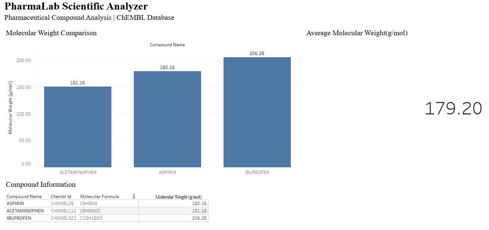
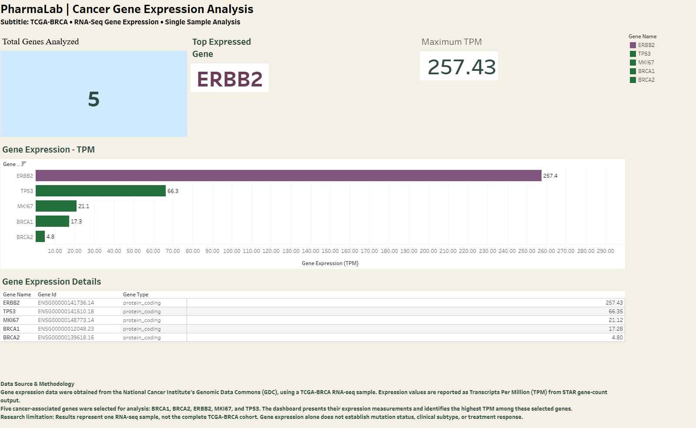

# PharmaLab Scientific Analyzer

**A Python Scientific Computing and Data Analysis Project for Pharmaceutical Research, Drug Discovery, and Cancer Genomics**

**Project Status:** Active Development  
**Author:** PhillaricaM  
**Primary Language:** Python 3.13  
**Research Focus:** Pharmaceutical Informatics, Cancer Genomics, Computational Biology, and Scientific Software Engineering

---

## 1. Project Overview

PharmaLab Scientific Analyzer is a Python-based scientific software engineering project designed to retrieve, validate, process, analyze, and visualize publicly available pharmaceutical and biomedical research data.

The project integrates multiple scientific data sources, including the **ChEMBL REST API** and the **National Cancer Institute (NCI) Genomic Data Commons (GDC) REST API**, to support pharmaceutical compound analysis and cancer gene-expression research.

PharmaLab currently supports two primary scientific workflows:

1. **Pharmaceutical Compound Analysis:** Retrieving chemical and molecular properties from ChEMBL, comparing pharmaceutical compounds, validating experimental data, and exporting structured results.
2. **Cancer Gene Expression Analysis:** Retrieving cancer research metadata and RNA-seq quantification datasets from the NCI GDC, analyzing selected cancer-associated genes, and exporting expression measurements.

The long-term objective is to develop PharmaLab into a modular scientific analysis platform supporting pharmaceutical research, computational oncology, biomedical data visualization, and machine-learning-assisted research workflows.

This project is part of an ongoing scientific software engineering portfolio focused on developing practical applications for biotechnology, pharmaceutical development, and cancer research.

---

## 2. Interactive Tableau Dashboards

PharmaLab includes two published Tableau Public dashboards that transform Python-generated scientific datasets into interactive research visualizations.

**Click either dashboard screenshot to open its live, interactive Tableau Public dashboard.**

### Dashboard 1 — Pharmaceutical Compound Analysis

**Data Source:** ChEMBL Database  
**Technologies:** Python, pandas, ChEMBL REST API, Tableau Public

This dashboard explores the molecular properties of three pharmaceutical compounds:

- Aspirin — CHEMBL25
- Acetaminophen — CHEMBL112
- Ibuprofen — CHEMBL521

The dashboard includes molecular weight comparisons, an average molecular weight KPI, and a compound information table containing ChEMBL identifiers and molecular formulas.

[](https://public.tableau.com/app/profile/phillarica.monique.neal/viz/PharmaLabScientificAnalyzer_CompoundAnalysis/Dashboard1)

**[Open Interactive Compound Analysis Dashboard](https://public.tableau.com/app/profile/phillarica.monique.neal/viz/PharmaLabScientificAnalyzer_CompoundAnalysis/Dashboard1)**

### Dashboard 2 — Cancer Gene Expression Analysis

**Data Source:** National Cancer Institute Genomic Data Commons  
**Research Project:** TCGA-BRCA — Breast Invasive Carcinoma  
**Dataset:** Single RNA-seq sample  
**Technologies:** Python, pandas, NCI GDC REST API, Tableau Public

This dashboard examines gene-expression measurements for five cancer-associated genes: ERBB2, TP53, MKI67, BRCA1, and BRCA2.

**Dashboard Features**

- Total genes analyzed: **5**
- Highest-expressed selected gene: **ERBB2**
- Maximum measured TPM: **257.43**
- Horizontal gene-expression comparison chart
- Gene details table with Ensembl identifiers and gene classifications
- Data source, methodology, and research limitations

[](https://public.tableau.com/app/profile/phillarica.monique.neal/viz/PharmaLab_Cancer_Gene_Expression/PharmaLabCancerGeneExpressionDashboard)

**[Open Interactive Cancer Gene Expression Dashboard](https://public.tableau.com/app/profile/phillarica.monique.neal/viz/PharmaLab_Cancer_Gene_Expression/PharmaLabCancerGeneExpressionDashboard)**

**Scientific Interpretation:** Gene expression is reported using Transcripts Per Million (TPM), extracted from STAR gene-count output. The dashboard presents five selected genes from one TCGA-BRCA RNA-seq sample, not the complete cancer cohort.

Gene-expression measurements alone do not establish mutation status, clinical HER2 status, cancer subtype, or treatment response.

### Scientific Data Visualization Workflow

**Scientific APIs → Python Processing → Data Validation → CSV Exports → Tableau Dashboards**

Both dashboards demonstrate how scientific software engineering connects biomedical data acquisition, computational analysis, and interactive visualization.

---

## 3. Technologies and Development Tools

### Programming and Data Analysis

- Python 3.13
- pandas
- NumPy
- requests
- JSON
- CSV and TSV data processing
- pathlib

### Scientific Data Sources

- ChEMBL REST API
- NCI Genomic Data Commons (GDC) REST API
- The Cancer Genome Atlas (TCGA), accessed through GDC

### Testing and Visualization

- pytest
- Matplotlib
- Tableau Public

### Development Environment

- Visual Studio Code
- Python virtual environments
- Git and GitHub
- Windows PowerShell

### Planned Technologies

- scikit-learn
- SciPy for advanced statistical analysis
- C++20
- pybind11
- Additional biomedical research APIs
- Interactive scientific web applications

---

## 4. Current Features

### Pharmaceutical Compound Analysis

- Connect to the ChEMBL REST API.
- Retrieve pharmaceutical compound information.
- Extract molecular formula, molecular weight, LogP, and polar surface area (PSA).
- Compare multiple pharmaceutical compounds.
- Organize molecular properties using pandas DataFrames.
- Export compound comparison results to CSV.
- Visualize molecular properties through Tableau.
- Validate experimental datasets using Python.
- Execute automated validation tests with pytest.

### Cancer Gene Expression Analysis

- Connect to the NCI GDC REST API.
- Retrieve cancer research project metadata.
- Discover publicly accessible RNA-seq gene-expression quantification files.
- Download RNA-seq datasets from GDC.
- Process tab-separated genomic datasets using pandas.
- Identify gene names, Ensembl gene identifiers, gene types, and expression measurements.
- Exclude sequencing summary rows from gene-level analysis.
- Extract expression measurements for selected cancer-associated genes.
- Sort gene-expression results using TPM.
- Export selected gene-expression measurements to CSV.
- Visualize selected gene-expression measurements through Tableau.

---

## 5. Pharmaceutical Compound Analysis

The initial PharmaLab workflow focuses on retrieving and comparing molecular properties of pharmaceutical compounds.

### Compounds Analyzed

| Compound | ChEMBL ID |
|---|---|
| Aspirin | CHEMBL25 |
| Acetaminophen | CHEMBL112 |
| Ibuprofen | CHEMBL521 |

### Molecular Properties

The project retrieves and compares:

- Molecular formula
- Molecular weight
- LogP (lipophilicity)
- Polar surface area (PSA)

These properties provide a foundation for exploring molecular characteristics relevant to pharmaceutical research and computational drug discovery.

### Workflow

1. Connect to the ChEMBL REST API.
2. Retrieve compound information using ChEMBL identifiers.
3. Extract selected molecular properties.
4. Organize results into pandas DataFrames.
5. Compare compounds and calculate summary statistics.
6. Export results to CSV.
7. Visualize molecular properties using Tableau.

**Output:** `results/compound_comparison.csv`

---

## 6. Cancer Gene Expression Analysis

PharmaLab has been expanded to include cancer genomics research using publicly available datasets from the National Cancer Institute's Genomic Data Commons.

### Research Dataset

**Project:** TCGA-BRCA  
**Cancer Type:** Breast Invasive Carcinoma  
**Data Source:** NCI Genomic Data Commons  
**Data Type:** RNA-seq Gene Expression Quantification  
**File Format:** TSV

### Dataset Characteristics

| Dataset Characteristic | Value |
|---|---:|
| Total rows | 60,664 |
| Total columns | 9 |
| RNA-seq files discovered | 5 |
| RNA-seq files downloaded | 1 |
| Cancer-associated genes selected | 5 |

The dataset includes gene identifiers, gene names, gene classifications, sequencing counts, and normalized expression measurements.

### Gene Expression Measurements

The following measurements are available:

- Unstranded gene counts
- First-strand gene counts
- Second-strand gene counts
- Transcripts Per Million (TPM)
- Fragments Per Kilobase of transcript per Million mapped reads (FPKM)
- Upper-quartile-normalized FPKM (FPKM-UQ)

The current exploratory analysis uses `tpm_unstranded` as its primary expression measurement.

### Cancer-Associated Genes

The initial analysis focuses on five genes relevant to cancer biology.

| Gene | Biological Relevance |
|---|---|
| BRCA1 | DNA damage repair and genome stability |
| BRCA2 | Homologous recombination and DNA repair |
| TP53 | Tumor suppression and cell-cycle regulation |
| ERBB2 | HER2-mediated growth signaling |
| MKI67 | Cellular proliferation |

### Example Gene Expression Results

The following expression measurements were obtained from one TCGA-BRCA RNA-seq sample.

| Gene | TPM |
|---|---:|
| ERBB2 | 257.4313 |
| TP53 | 66.3478 |
| MKI67 | 21.1180 |
| BRCA1 | 17.2767 |
| BRCA2 | 4.8031 |

ERBB2 has the highest TPM value among these five selected genes in this sample.

These results are descriptive measurements from a single sample. They do not establish differential gene expression, mutation status, clinical HER2 status, or treatment response.

### Cancer Genomics Workflow

1. Connect to the NCI GDC REST API.
2. Retrieve cancer project information.
3. Discover open-access RNA-seq quantification files.
4. Download a selected gene-expression dataset.
5. Load the dataset into a pandas DataFrame.
6. Inspect dataset dimensions, columns, and data types.
7. Remove non-gene sequencing summary rows.
8. Select cancer-associated genes.
9. Extract and sort gene-expression measurements.
10. Export results for visualization and further analysis.

**Output:** `results/tcga_brca_gene_expression.csv`

---

## 7. Project Structure

```text
PharmaLab-Scientific-Analyzer/
│
├── src/
│   ├── chembl_api.py
│   ├── compare_compounds.py
│   ├── compound_lookup.py
│   ├── data_validation.py
│   ├── explore_data.py
│   ├── molecular_properties.py
│   ├── gdc_api.py
│   └── gene_expression_analysis.py
│
├── tests/
│   └── test_data_validation.py
│
├── data/
│   ├── drug_response.csv
│   └── gdc/
│       └── downloaded RNA-seq files
│
├── results/
│   ├── compound_comparison.csv
│   └── tcga_brca_gene_expression.csv
│
├── docs/
│   └── images/
│       ├── compound_analysis_dashboard.png
│       └── cancer_gene_expression_dashboard.png
│
├── Tableau dashboards/
│
├── main.py
├── requirements.txt
├── .gitignore
└── README.md
```

The `data/gdc/` directory stores downloaded RNA-seq datasets locally. Raw datasets are excluded from Git version control.

The repository includes exported analysis results and source code so the scientific workflows can be reviewed and reproduced.

The `docs/images/` directory contains the screenshots used for the clickable Tableau dashboard previews in this README.

---

## 8. Installation and Setup

### Prerequisites

- Python 3.13
- Git
- Visual Studio Code or another Python-compatible development environment
- Internet access for biomedical API requests

### Clone the Repository

```powershell
git clone https://github.com/PhillaricaM/PharmaLab-Scientific-Analyzer.git
cd PharmaLab-Scientific-Analyzer
```

### Create a Virtual Environment

```powershell
python -m venv .venv
```

Activate the environment in Windows PowerShell:

```powershell
.\.venv\Scripts\Activate.ps1
```

### Install Dependencies

```powershell
python -m pip install -r requirements.txt
```

---

## 9. Running the Scientific Workflows

### Pharmaceutical Compound Analysis

Retrieve compound information from ChEMBL:

```powershell
python src/chembl_api.py
```

Run the compound comparison workflow:

```powershell
python src/compare_compounds.py
```

### Cancer Gene Expression Analysis

Retrieve GDC project information, discover gene-expression files, and download an open-access dataset:

```powershell
python src/gdc_api.py
```

Analyze the downloaded RNA-seq dataset:

```powershell
python src/gene_expression_analysis.py
```

The gene-expression analysis script loads a locally downloaded TSV dataset, inspects its structure, extracts selected cancer-associated genes, and exports the results.

### Automated Testing

```powershell
python -m pytest tests/
```

---

## 10. Data Validation and Testing

PharmaLab includes a data-validation module designed to identify common problems in experimental datasets.

### Implemented Validation Checks

- Missing values
- Negative concentration measurements
- Inhibition percentages outside the expected range

These checks help improve data quality before scientific analysis.

Automated tests are implemented using pytest.

### Planned Testing Improvements

- Unit tests for ChEMBL API response handling
- Unit tests for GDC API functions
- Mocked API responses
- Gene-expression dataset schema validation
- Missing or invalid gene identifier checks
- Scientific calculation verification
- Additional error-handling and edge-case tests

---

## 11. Development Progress and Accomplishments

### Phase 1 — Project Setup and Python Environment

**Status: Completed**

- Established the project directory structure.
- Configured Python 3.13 and a virtual environment.
- Installed scientific Python libraries.
- Created modular source-code directories.
- Initialized Git version control.
- Published the project to GitHub.

### Phase 2 — Pharmaceutical Data Integration

**Status: Completed for initial scope**

- Connected to the ChEMBL REST API.
- Retrieved pharmaceutical compound information.
- Extracted molecular properties.
- Compared three pharmaceutical compounds.
- Organized results using pandas.
- Exported compound analysis results to CSV.

### Phase 3 — Data Validation and Compound Visualization

**Status: Completed for initial scope**

- Implemented experimental data-validation functions.
- Developed automated pytest tests.
- Created pharmaceutical compound visualizations in Tableau.
- Published the interactive Compound Analysis dashboard.

### Phase 4 — Cancer Genomics API Integration

**Status: Completed for initial scope**

- Connected to the NCI GDC REST API.
- Retrieved cancer project metadata.
- Identified the TCGA-BRCA research project.
- Discovered five open-access gene-expression files.
- Implemented RNA-seq dataset downloading.
- Downloaded the first TCGA-BRCA expression file.

### Phase 5 — Cancer Gene Expression Analysis

**Status: Completed for initial scope**

- Loaded a 60,664-row RNA-seq dataset into pandas.
- Inspected dataset columns and data types.
- Identified gene-expression quantification measurements.
- Excluded sequencing summary rows from gene-level analysis.
- Extracted five cancer-associated genes.
- Sorted results by TPM expression level.
- Exported the analysis to CSV.
- Published the updated scientific code and results to GitHub.

### Phase 6 — Cancer Gene Expression Visualization

**Status: Completed for initial scope**

- Created a Tableau cancer gene-expression dashboard.
- Visualized TPM measurements for five selected cancer-associated genes.
- Developed gene-expression KPI worksheets.
- Created a gene-expression details table.
- Documented dataset sources, methodology, and analytical limitations.
- Published the interactive Cancer Gene Expression dashboard to Tableau Public.

---

## 12. Development Roadmap

### Phase 7 — Multi-Sample Cancer Genomics

**Status: Planned**

- Retrieve additional RNA-seq samples.
- Retrieve sample and case metadata.
- Identify tumor and normal tissue sample classifications.
- Develop reproducible multi-sample data-processing workflows.
- Explore gene-expression patterns across samples.
- Introduce appropriate statistical methods for comparing expression measurements.

### Phase 8 — Advanced Scientific Analysis

**Status: Planned**

- Expand pharmaceutical compound analysis.
- Explore anticancer compounds and associated research datasets.
- Implement dose-response analysis.
- Introduce IC50 estimation.
- Expand scientific statistical analysis.
- Improve data validation and automated testing.

### Phase 9 — Machine Learning Integration

**Status: Planned**

- Introduce scikit-learn.
- Explore feature selection and preprocessing.
- Investigate machine learning for gene-expression analysis.
- Develop exploratory predictive models using suitable research datasets.
- Evaluate models using appropriate validation strategies.
- Investigate computational methods relevant to drug discovery.

### Phase 10 — Integration with OncoCompute

**Status: Planned**

Investigate integration with **OncoCompute**, a separate C++20 scientific computing project for cancer drug discovery.

Potential integration features include:

- Reusable C++ statistical algorithms
- Scientific numerical calculations
- Dose-response and IC50 computations
- Python bindings using pybind11
- Performance comparisons between Python and C++ implementations

The goal is to explore how Python-based biomedical data processing can interact with reusable high-performance scientific computing components.

### Phase 11 — Interactive Scientific Research Application

**Status: Long-Term Development**

Explore transforming PharmaLab into a web-based scientific research application.

Potential capabilities include:

- Interactive biomedical data exploration
- Scientific API integration
- User-directed dataset queries
- Automated research data summaries
- Interactive scientific visualizations
- Natural-language-assisted exploration of research datasets
- Integration with Tableau or other visualization systems

Any future AI-assisted features would require appropriate validation, traceability, and safeguards against unsupported scientific conclusions.

---

## 13. Scientific Applications

PharmaLab explores software engineering techniques relevant to:

- Pharmaceutical research and development
- Drug discovery
- Computational oncology
- Cancer genomics
- Bioinformatics
- Scientific data analysis
- Biomedical research informatics
- Biotechnology research
- Research data visualization
- Scientific application development

The project emphasizes reproducible computational workflows, modular Python development, public scientific data integration, and research-oriented software engineering.

---

## 14. Research Limitations

PharmaLab is a portfolio and educational scientific software development project.

The current gene-expression analysis is based on one publicly available RNA-seq sample. Its results are intended for exploratory analysis and demonstration of computational workflows.

Gene-expression measurements alone cannot establish clinical diagnoses, mutations, treatment efficacy, or differential expression between cancer and healthy tissue.

Future multi-sample analysis will require suitable metadata, biological replication, statistical methods, and careful interpretation.

**The software is not intended for clinical decision-making.**

---

## 15. Data Sources and References

- [ChEMBL Database](https://www.ebi.ac.uk/chembl/)
- [ChEMBL API](https://www.ebi.ac.uk/chembl/api/data/docs)
- [NCI Genomic Data Commons](https://portal.gdc.cancer.gov/)
- [GDC API Documentation](https://docs.gdc.cancer.gov/API/Users_Guide/Getting_Started/)
- [The Cancer Genome Atlas](https://www.cancer.gov/ccg/research/genome-sequencing/tcga)

---

## 16. Author

**PhillaricaM**

Scientific Software Engineering | Python | C++ | Pharmaceutical Research | Computational Oncology | Bioinformatics

GitHub: [https://github.com/PhillaricaM](https://github.com/PhillaricaM)

**Project Status:** Active Development

**Current Development Priority:** Multi-Sample Cancer Genomics, Advanced Scientific Analysis, and Continued PharmaLab Development